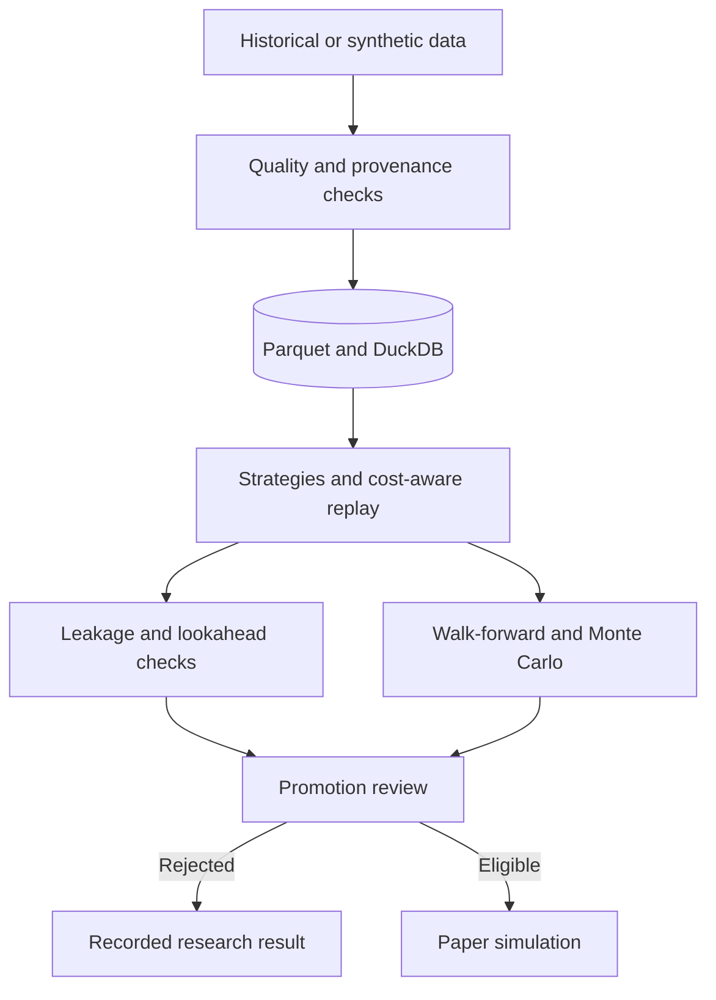
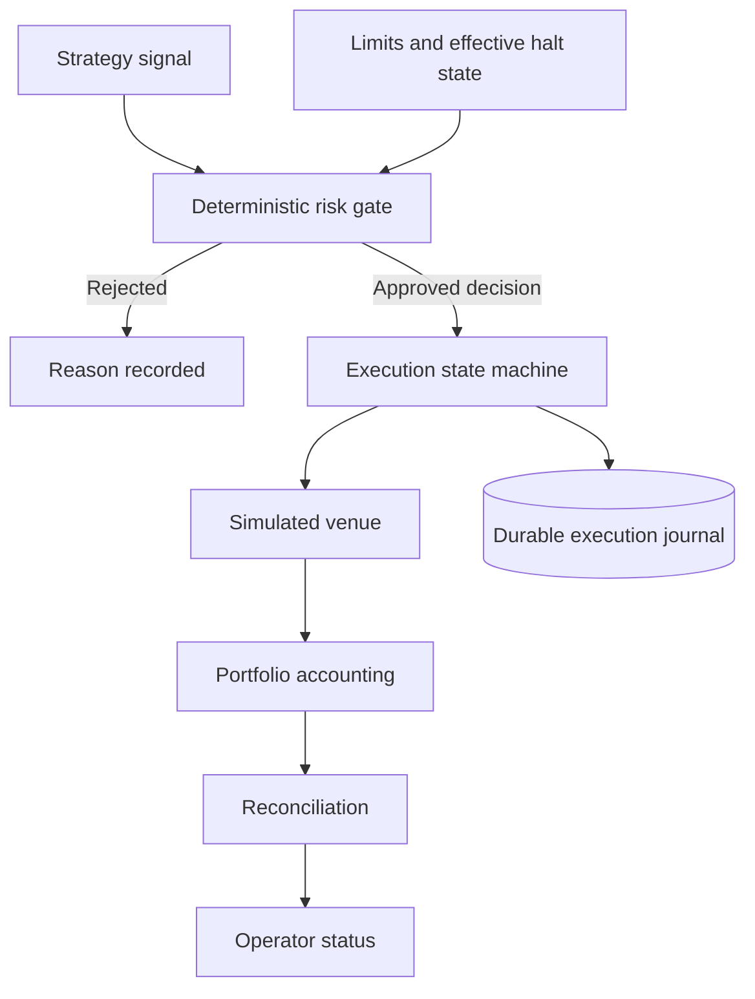

# FXQuant — Architecture

**Altin Kalludra** · [Overview](README.md) · [Visual walkthrough](WALKTHROUGH.md)

## Application layers

| Layer | Responsibility | Technology |
|---|---|---|
| Operator interface | Research configuration, data inventory, risk controls, paper-session status | React, TypeScript, Tailwind |
| API | Request validation, service orchestration, progress and reporting | FastAPI, Pydantic |
| Application services | Data ingestion, optimization, sessions, execution journal, reconciliation | Python |
| Domain layer | Indicators, signals, sizing, risk decisions, analytics | Pure Python domain logic |
| Research storage | Partitioned price history and analytical queries | Parquet, DuckDB |

Dependencies point from the interface to services to domain logic. Keeping
framework and I/O concerns out of the domain layer supports isolated tests of
capital-related decisions.

## Research flow

Real and synthetic inputs must be distinguished. A strong in-sample result is
only a research finding; validation examines out-of-sample behavior, costs,
stability, and data leakage before any promotion decision.

## Risk-controlled paper order path

The execution journal's durability is a different concern from halt-state
durability. The Python application's halt state still needs a shared,
authenticated record across restarts and processes.

## MetaTrader and charting boundary

The Python MT5 adapter implements read-side broker data and account inspection;
its order-write methods refuse execution. The private XAUUSD EA is a separate
desktop artifact with explicit advisory and demo modes, centralized execution,
and a manual-trade assistant. Pine is the charting/signal companion.

Source-level checks of these artifacts do not prove that MetaTrader fills match
Python replay. Compilation, a desktop Strategy Tester export, and independent
per-trade comparison remain required verification steps.

## Engineering decisions

| Decision | Purpose | Limit |
|---|---|---|
| Explicit bid/ask and cost convention | Avoid optimistic fills and duplicated spread charges | Broker fill parity still needs independent evidence |
| Confirmed-bar signal timing | Avoid same-bar lookahead | Intrabar/tick handling must be verified separately |
| Risk decision required before execution | Keep capital policy in one authoritative gate | Multi-process halt synchronization remains incomplete |
| Idempotent order state and reconciliation | Detect duplicates and position disagreement | Simulated fills do not model every real venue effect |
| Missing metrics stay missing | Avoid making absent measurements look like zero | Old screenshots can lag current backend behavior |
| Local-first deployment | Keep the development runtime controlled | API authentication remains necessary before remote exposure |

[Evidence and limitations](EVIDENCE.md) · [Back to overview](README.md)

© Altin Kalludra. All rights reserved.
