<div align="center">

# FXQuant

**A local-first algorithmic trading platform whose most important feature is rejecting bad strategies.**

Research → validation → paper → live, for forex and crypto.

[](#project-status)
[](#engineering-highlights)
[](#the-one-rule)
[](#ownership)

</div>

> **This repository is a portfolio case study, not a source mirror.** The production
> implementation is private and proprietary. See [Ownership](#ownership).

---

## The premise

Most trading software is sold on the promise of returns. This one is built on the
opposite premise: **the value is in the rejection.**

Every stage of the pipeline exists to make it *harder* for a strategy to reach real
capital. A high backtest profit buys nothing. It has to clear gates on out-of-sample
behaviour, walk-forward consistency, Monte Carlo ruin probability, parameter stability,
cost sensitivity and leakage — and a failed leakage scan forces the robustness score to
zero, with no partial credit.

If that sounds like it will reject most ideas, it will. That is the feature.

---

## Screenshots

| Dashboard — trading permissions | Strategy library |
| :---: | :---: |
| 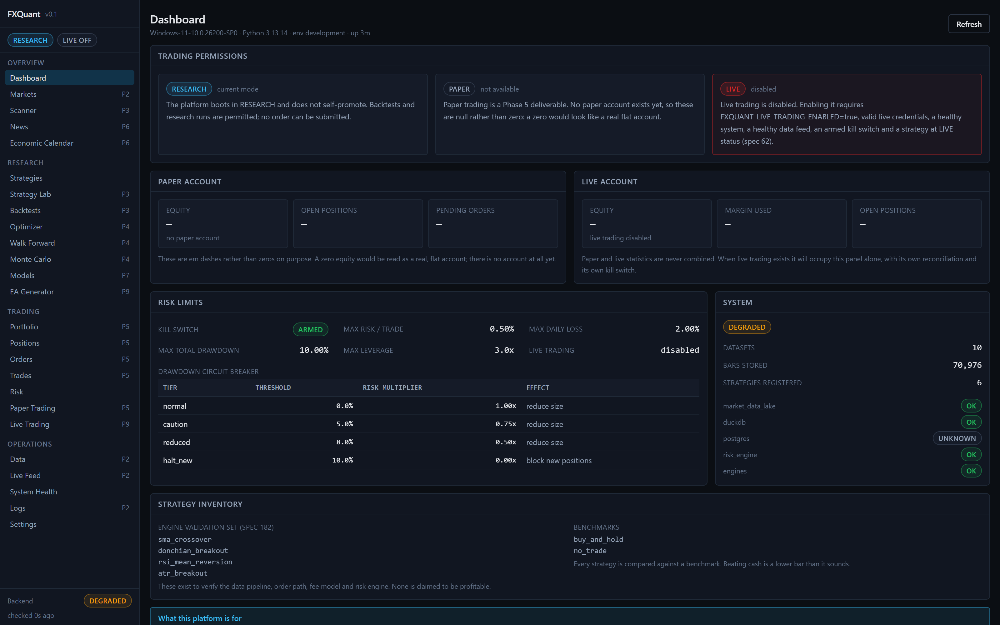 | 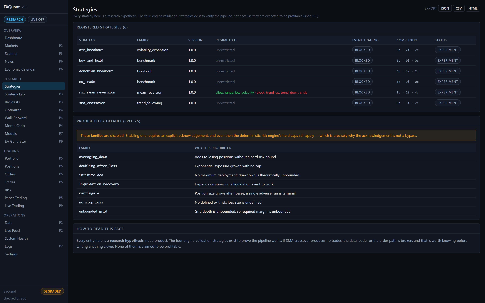 |

| Cross-dataset scanner | Strategy lab |
| :---: | :---: |
| 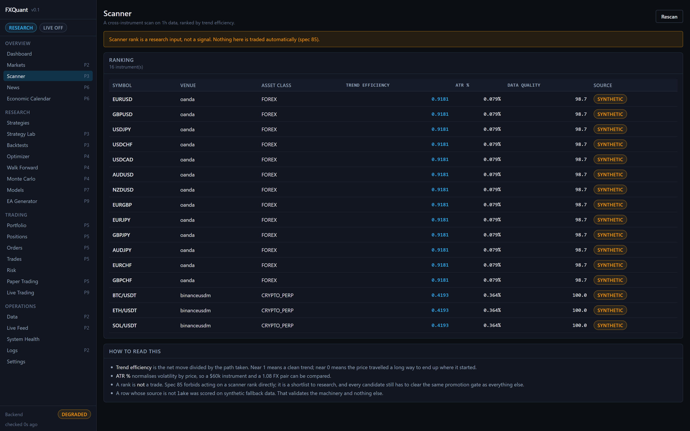 | 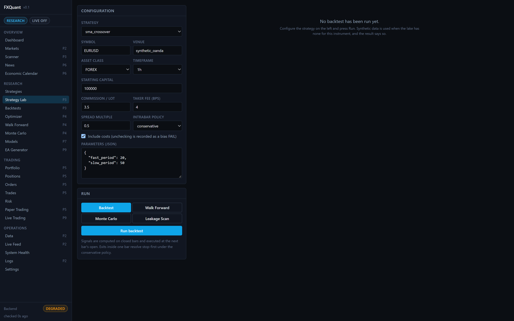 |

| Risk engine | Market-data lake |
| :---: | :---: |
| 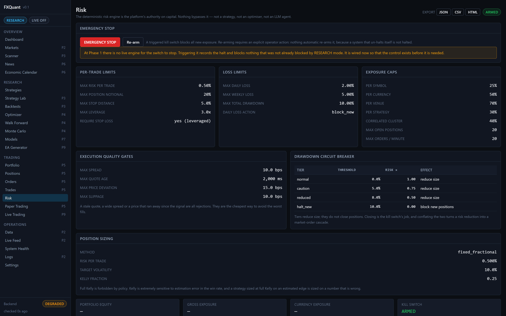 | 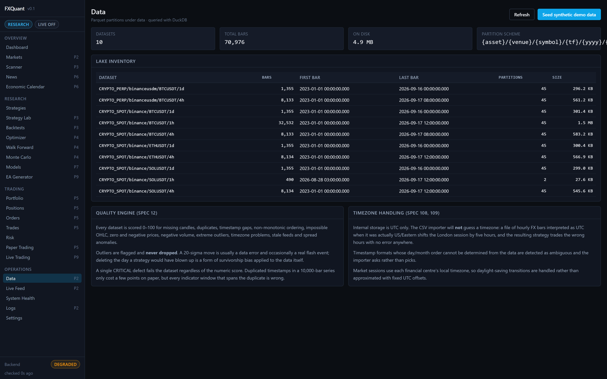 |

| Markets | EA generator |
| :---: | :---: |
| 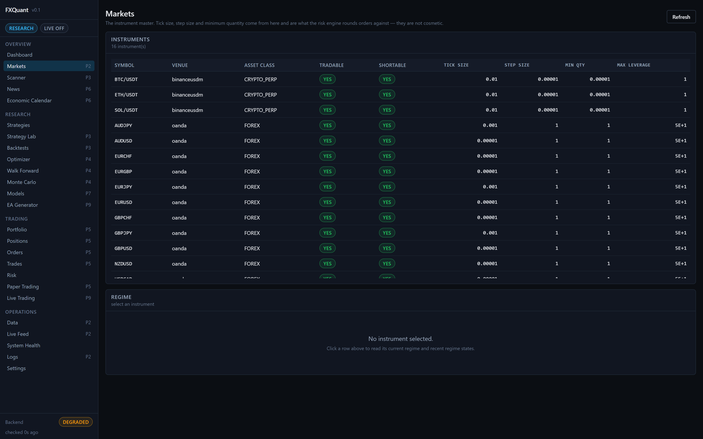 | 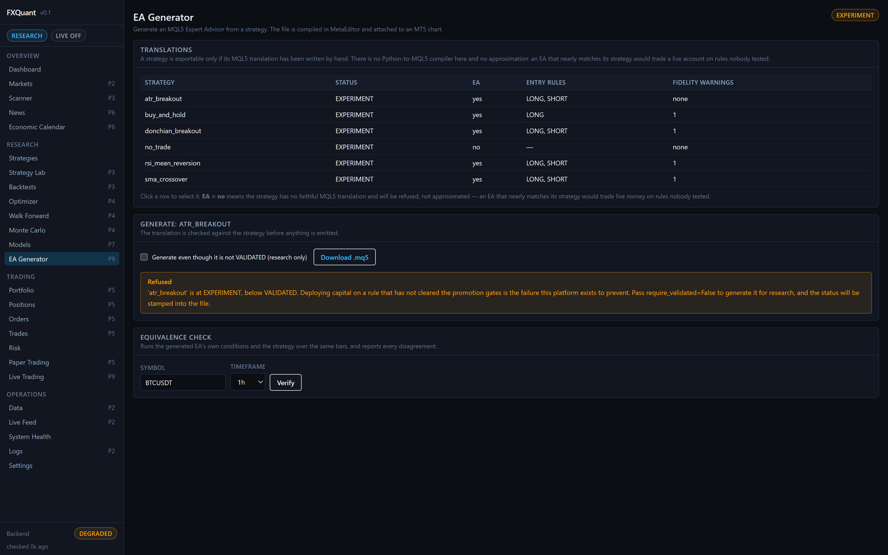 |

| Paper trading | System health |
| :---: | :---: |
| 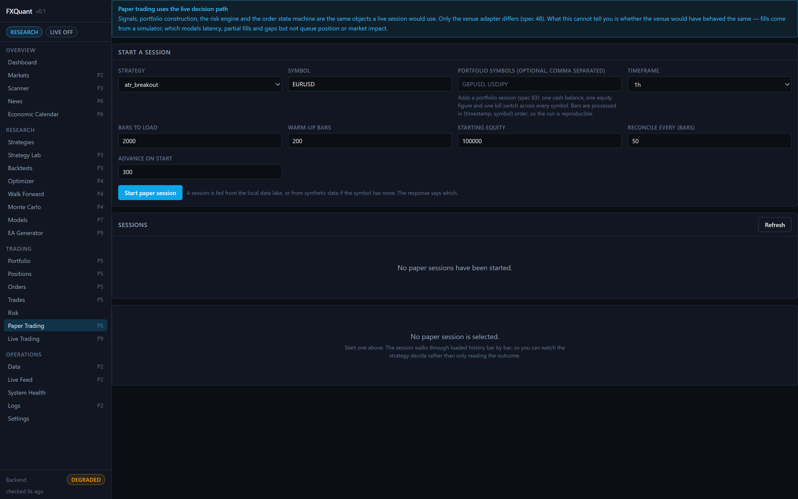 | 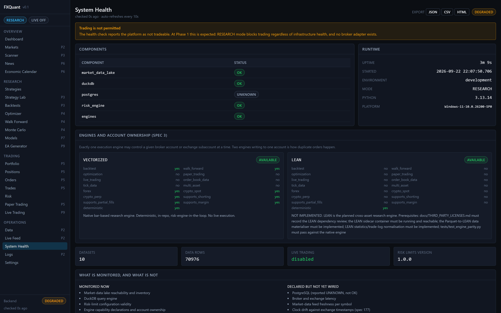 |

---

## The one rule

```
Strategy signal  ──►  [DETERMINISTIC RISK ENGINE]  ──►  Order
                              ▲
                              └── nothing bypasses this
```

Not a strategy. Not a portfolio optimiser. Not a critic agent. Not an LLM.

An AI may propose `BUY EURUSD`. It produces a *structured signal* — symbol, direction,
confidence, horizon, reason codes, risk tags. The risk engine decides whether that becomes
an order.

This is enforced **structurally**, not by convention: `RiskDecision` is the only type the
executor accepts, and `assert_tradeable` raises rather than returning a falsy value. It is
additionally verified by property tests over generated inputs, so "no input may breach a
hard cap" is an invariant rather than an example.

---

## What the platform refuses to do

These are enforced in code, not documented as intentions.

| Refusal | Mechanism |
|---|---|
| Trade in RESEARCH mode | `_check_research_mode_block` — always fails |
| Read a future bar | `is_bar_visible`; signals execute at the next bar's open |
| Use a leaked feature | `LeakageScanner` — a fatal finding blocks deployment |
| Random time-series splits | `scan_splits` rejects interleaved train/test |
| Use revised macro data in a backtest | `EconomicEvent.safe_for_backtest` is False without a vintage |
| Trade through a stale quote | `_check_quote_freshness` |
| Trade through a wide spread | `_check_spread_limit` |
| Exceed any hard limit | 35 checks, property-tested |
| Enable martingale by default | `PROHIBITED_BY_DEFAULT` requires explicit acknowledgement |
| Use full Kelly | Rejected at config validation |
| Silently retry a non-idempotent order | `client_order_id` uniqueness |
| Confuse paper and live statistics | Separate blocks, nulls not zeros |
| Run a test process with live credentials | `assert_environment_safe` refuses to start |
| Return a plausible number for an unimplemented feature | `EngineNotSupportedError`, HTTP 501 |

---

## Features

**Research and validation**
- 68 causal technical indicators, each with a causality test
- Market session engine (DST-aware) and market regime engine
- Leakage and lookahead scanner with 13 defect classes
- Event-driven backtester with a full cost model — long fills at the ask, exits at the bid, never the mid
- Walk-forward analysis, including in-window optimisation
- Monte Carlo across 6 perturbation modes
- Probabilistic and Deflated Sharpe ratios
- Robustness scoring and a configurable promotion-gate ladder
- Multi-objective parameter optimisation (Optuna) with Pareto frontier, parameter importance and stability surfaces
- Tail risk: VaR, Expected Shortfall, rolling ES — each reported with its own tail count
- 14 stress scenarios, dynamic correlation clusters, effective-bets

**Data**
- Parquet + DuckDB lake with monthly partitioning
- Real downloads: Binance and Coinbase without keys, OANDA practice for forex
- Data quality engine: 0–100 score across 13 defect classes
- CSV importer with a timezone wizard
- Deterministic synthetic generator (the demo needs no network)
- **Live Binance WebSocket feed**: trades, order book and bookTicker, with order-book reconstruction from snapshot + delta, sequence validation, reconnect with backoff, and clock-drift monitoring

**Execution**
- Order state machine with idempotency and reconciliation
- Durable execution journal — order state survives a restart
- Simulated venue with fault injection
- Execution-quality measurement against backtest assumptions
- Paper trading on the live decision path

**Expert Advisor generation**
- Emits MetaTrader 5 `.mq5` source from a validated strategy
- Provenance embedded: strategy id, version, parameters, SHA-256 hash, and a magic number derived from that hash
- **Refuses to export a strategy below `VALIDATED`** unless explicitly overridden for research — and stamps the status into the generated file
- Fidelity warnings printed at the top of the file for behaviour the EA does *not* reproduce
- **Equivalence verification**: the generated MQL5 conditions are evaluated against the strategy over real bars to prove they agree

**Platform**
- FastAPI backend with WebSocket progress, React + TypeScript terminal
- 1,637 tests, GitHub Actions CI with dedicated risk and lookahead gates
- Docker Compose stack

---

## Technology

| Layer | Stack |
| :--- | :--- |
| **Backend** | Python 3.13, FastAPI, pydantic 2 |
| **Data** | pandas 3, numpy 2, DuckDB, Parquet |
| **Analytics** | Optuna, scipy, Hypothesis (property tests) |
| **Frontend** | React 18, TypeScript, Tailwind, Vite |
| **Charts** | lightweight-charts |
| **Infra** | Docker Compose, GitHub Actions |
| **Quality** | ruff, black, mypy (zero ignores across first-party packages) |

---

## Architecture

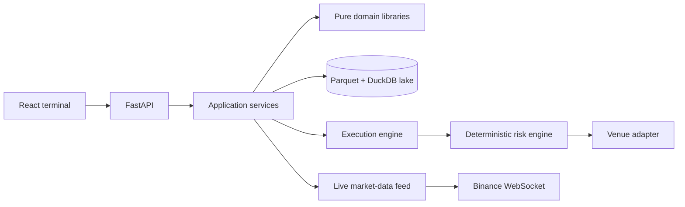

Dependency direction is **one-way**: `apps → services → libs`. This is enforced by
`tests/test_architecture.py`, which parses every file under `libs/` and fails if it imports
`services` or `apps`.

- **`libs/`** — pure and testable without I/O. Domain models, indicators, features, strategies, risk models, analytics.
- **`services/`** — stateful. The data lake, streaming, strategy runner, scheduler, ops.
- **`apps/`** — the HTTP API, the React terminal, and the operator CLI.

The constraint that makes the rest work: **`libs/` never does I/O.** Databases, network and
clocks live only in `services/`. That is what makes the risk engine testable in isolation —
and the risk engine is the component that must never be wrong.

---

## Engineering highlights

**Honest numbers, everywhere.** The API returns `null` where it has no answer, rendered as
an em dash. A zero looks like a measurement, so a missing number is never a zero. An
infinite profit factor is `None` — "no losses in this sample" is not a number. A 99% VaR
computed from 60 observations is the sample minimum wearing a confidence level, and the
report says so rather than printing a figure without context.

**Costs are always modelled.** A cost-free backtest is possible but flagged as a bias
`FAIL`. Entry and exit sides are explicit: long entries fill at the ask, exits at the bid.
Intrabar ambiguity resolves *against* us — when a stop and a target are both inside one
bar, the stop wins.

**Outliers are flagged, never dropped.** A 20-sigma move is usually a data error and
occasionally a real flash event. Deleting the day a strategy would have blown up is
survivorship bias applied to the data.

**Annualisation is measured, not assumed.** The periods-per-year factor comes from the
data's own timestamps, because crypto trades weekends and forex does not.

**The optimiser searches on one objective and ranks on another.** Optuna needs a scalar;
the composite score needs the whole trial population. Handing a scalarised objective to TPE
would let the surrogate trade a catastrophic drawdown for a slightly better Sortino.
Parameter stability is folded into the ranking, so a spike in a parameter surface cannot
win by performing well at one exact value.

**A "USD shock" is not a shock to EURUSD — it is a shock to one leg of EURUSD.** Shocks are
expressed on dimensions and resolved through each instrument's own structure, so one rule
moves EURUSD down and USDJPY up with no per-pair configuration, and a USDT depeg correctly
*raises* the USDT price of crypto.

**Reconciliation reports; it never repairs.** A system that silently "fixes" a position
disagreement with a venue is a system that can silently invent a position.

**Kelly is always fractional and hard-capped.** Full Kelly maximises growth only under
assumptions that never hold.

**The kill switch cannot un-halt itself.** Re-arming requires an explicit operator action.

---

## Testing philosophy

**The distribution matters more than the count.** 1,637 tests, and the interesting ones are
the ones that can fail for a real reason:

- **278 causality tests** verify every indicator is causal by recomputing it on truncated
  input. This catches `center=True`, `bfill` and whole-series normalisation without needing
  to understand the indicator.
- **Risk tests include Hypothesis property tests** at 200 examples each, because "no input
  may breach a hard cap" is an invariant, not an example.
- **Leakage tests each construct a *known* leak** and assert the scanner catches it. A
  scanner tested only on clean data is untested.
- **Equivalence tests** prove the generated MQL5 matches the strategy, and include
  deliberately broken variants (flipped comparison, wrong shift, changed stop) that must
  *fail* — otherwise the verifier proves nothing.

CI runs the risk and lookahead suites separately so a failure is unambiguous in the checks
list.

### Two silent-failure traps worth naming

Both were found during development and both are now pinned by tests.

**A fast path that silently wasn't.** Dataset statistics were re-implemented to read Parquet
footer metadata instead of loading the data — 23.4 s to 0.3 s across ten datasets. The first
version looked for a column literally named `timestamp`; the real name is `timestamp_utc`,
held in a constant. So the lookup raised on every dataset, every one silently took the
fallback branch, and the optimisation did nothing while still returning correct answers.
The lesson: **verify a fast path by asserting the slow path is *not* taken — monkeypatch it
to raise — not by eyeballing the result.** The test does exactly that.

**A test that could never pass.** An assertion matched the error text `"call start"`, but
the guard it exercised emits `"was stopped … start a new one to continue"`. The behaviour
was correct; the regex was stale and could never have matched. It had been failing silently
in the noise of an unrelated fixture-teardown issue.

---

## Project status

**Active development. RESEARCH mode. Live trading is disabled and no live broker adapter is
implemented.**

| Capability | Status |
|---|---|
| Market-data lake (Parquet + DuckDB) | ✅ |
| Real downloads: Binance, Coinbase (keyless), OANDA practice | ✅ |
| 68 causal technical indicators | ✅ |
| Leakage and lookahead scanner | ✅ |
| Deterministic risk engine (35 checks) | ✅ |
| Event-driven backtester with full cost model | ✅ |
| Walk-forward, Monte Carlo, robustness, promotion gates | ✅ |
| Parameter optimisation with Pareto and stability | ✅ |
| Tail risk, stress scenarios, correlation clusters | ✅ |
| FastAPI backend + React terminal | ✅ |
| Paper trading on the live decision path | ✅ |
| Order state machine, idempotency, reconciliation | ✅ |
| Live Binance WebSocket feed | ✅ |
| **EA generator + equivalence verification** | ✅ |
| Live broker / exchange adapters | ❌ |
| Live trading | ❌ |
| Machine learning | ❌ |
| News / NLP | ❌ |

**The platform does not promise profitability, and it does not currently promote any
strategy.** Across the research universe (BTC/ETH/SOL, 2023-01 → 2026-09) every candidate
was measured against `buy_and_hold` and a `no_trade` control. Turnover dominates returns —
friction consumes roughly 107% of gross at 1h, 45% at 4h, 12.6% at 1d — and buy-and-hold
dominance turned out to be a regime artifact rather than a law. Reporting that honestly is
the point of the platform.

---

## Ownership

Built by **Altin** ([@ulasmango-cmd](https://github.com/ulasmango-cmd)).

- GitHub profile: [github.com/ulasmango-cmd](https://github.com/ulasmango-cmd)

---

## License

The production implementation is **private and proprietary**. This repository contains
portfolio documentation and product screenshots only — it intentionally does not include
application source code, business logic, infrastructure configuration or credentials.

© Altin. All rights reserved.
